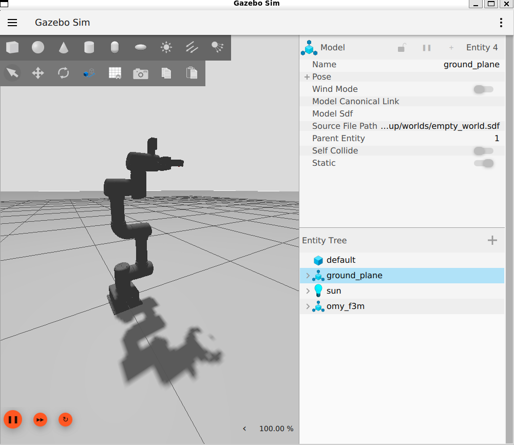

# ROS 2 Manipulator Learning

**ROS 2 Jazzy · MoveIt · Gazebo | 로봇팔 실습 및 구현 기록**

Windows의 WSL Ubuntu에서 로봇팔 시뮬레이션 환경을 구성하고, 이후 MoveIt 동작 계획과 로봇 제어 구현을 이어가는 학습 저장소입니다.

A learning repository documenting manipulator simulation setup on Windows with WSL Ubuntu, followed by planned MoveIt motion planning and robot control implementation.

## 실행 결과 / Demonstration

**2026-11-14 — Gazebo Sim에서 `omy_f3m` 로봇팔 모델 표시 성공.**

**November 14, 2026 — Successfully displayed the `omy_f3m` manipulator in Gazebo Sim.**



현재 검증 범위는 Gazebo 창 실행과 로봇 모델 표시입니다. 경로 계획과 관절 제어는 이후 실습에서 검증합니다.

Verified so far: Gazebo GUI startup and robot model visualization. Motion planning and commanded joint movement will be verified in later exercises.

## 진행 상황 / Progress

- [x] WSL Ubuntu 워크스페이스 생성 / Create a workspace in WSL Ubuntu
- [x] ROBOTIS 원본 다운로드 / Clone the ROBOTIS upstream repository
- [x] ROS 2 Jazzy 환경 불러오기 / Source the ROS 2 Jazzy environment
- [x] 기본 Gazebo 실행 / Launch a basic Gazebo example
- [x] 로봇팔 모델 표시 / Display the manipulator model
- [ ] 정확한 버전·원본 커밋·launch 명령 기록 / Record exact versions, upstream revision, and launch commands
- [ ] MoveIt 동작 계획 / MoveIt motion planning
- [ ] 관절 제어 및 동작 검증 / Joint control and motion verification
- [ ] 이후 구현 코드·설정·영상 추가 / Add subsequent implementations, configurations, and videos

## 환경 / Environment

| 항목 / Item | 환경 / Environment |
| --- | --- |
| Host | Windows |
| Linux | WSL Ubuntu — exact version to be recorded |
| ROS | ROS 2 Jazzy |
| Simulator | Gazebo Sim — exact version to be recorded |
| Upstream | ROBOTIS-GIT/open_manipulator |
| Displayed model | `omy_f3m` |
| Workspace | `~/moveit_ws` |
| Rendering setting used | `LIBGL_ALWAYS_SOFTWARE=1` |

## 주요 명령 / Commands Used

아래는 실습 중 사용한 명령이며, 전체 설치 가이드는 아닙니다. Ubuntu 터미널에서 실행합니다. `~$` 같은 프롬프트는 입력하지 않습니다.

These commands document the exercise; they are not a complete installation guide. Run them in Ubuntu without copying shell prompt characters such as `~$`.

### 소스 준비 / Prepare source

```bash
mkdir -p ~/moveit_ws/src
cd ~/moveit_ws/src
git clone https://github.com/ROBOTIS-GIT/open_manipulator.git
```

### ROS 환경·의존성 / ROS environment and dependencies

```bash
source /opt/ros/jazzy/setup.bash
echo $ROS_DISTRO
cd ~/moveit_ws
rosdep install --from-paths src --ignore-src -r -y
```

`ROS_DISTRO`가 `jazzy`인지 확인하고, rosdep의 마지막 문구뿐 아니라 위쪽 오류와 실패 목록도 확인합니다.

Check that `ROS_DISTRO` is `jazzy`. Review earlier errors and failed packages rather than relying only on the final rosdep message.

### 기본 Gazebo 확인 / Test basic Gazebo startup

```bash
source /opt/ros/jazzy/setup.bash
LIBGL_ALWAYS_SOFTWARE=1 gz sim -v 4 shapes.sdf
```

### 기존 빌드 결과 사용 / Use an existing workspace build

`install/local_setup.bash`가 생성된 워크스페이스에서 실행합니다. / Run in a workspace that already contains the generated `install/local_setup.bash`.

```bash
cd ~/moveit_ws
source /opt/ros/jazzy/setup.bash
source install/local_setup.bash
export LIBGL_ALWAYS_SOFTWARE=1
```

이후 로봇 launch 명령을 실행합니다. 정확한 launch 명령과 빌드 옵션은 확인 후 추가합니다.

Then run the robot launch command. The exact command and build options will be added after verification.

## 문제 해결 / Troubleshooting

| 증상 / Symptom | 조치 / Action | 결과 / Outcome |
| --- | --- | --- |
| `mkdir -p` failed in Anaconda Prompt | Ubuntu 터미널로 전환 / Use the Ubuntu shell | Workspace created |
| Git clone requested a username | `ROBOTICS-GIT` → `ROBOTIS-GIT` 주소 수정 / Correct repository owner | Clone completed |
| `ROS distro is not set` | Source `/opt/ros/jazzy/setup.bash` | Jazzy recognized |
| Multiple apt dependency failures | 패키지 목록·개별 설치 오류 확인 / Inspect apt update and individual installation errors | Full dependency status needs a separate check |
| `source_install/local_setup.bash` not found | `source install/local_setup.bash`로 공백 수정 / Correct spacing | Command syntax corrected |
| `WARN:COPY MODE`, invisible GUI | WSL 재시작, ROS 환경 재적용, 소프트웨어 렌더링 / Restart WSL, source ROS, use software rendering | Gazebo and robot model displayed |
| `gz: command not found` in a new terminal | ROS 환경 다시 적용 / Source ROS again | Gazebo launched |
| Missing `realsense2_description/meshes/d405.stl` | 카메라 패키지·모델 경로 확인 대상 / Camera package and resource path require checking | Robot displayed; disappearance of this specific log is unverified |

여러 조치를 순차 적용했으므로 창 표시 문제의 단일 원인은 확정하지 않았습니다. 소프트웨어 렌더링은 느려질 수 있습니다.

Several changes were applied in sequence, so a single root cause of the GUI issue has not been established. Software rendering may reduce performance.

## 학습 개념 / Concepts

| 개념 / Concept | 설명 / Description |
| --- | --- |
| description package | 로봇 구조·형상 자원 / Robot description and visual assets, including URDF/Xacro and meshes |
| URDF | 링크·관절·형상·물리 정보를 표현하는 XML / XML representation of links, joints, geometry, and physical properties |
| `source` | 현재 셸에 환경 설정 적용 / Apply environment settings to the current shell |
| rosdep | 외부 의존성 확인·설치 / Resolve and install external package dependencies |
| Gazebo / MoveIt | 시뮬레이션 / 동작 계획 / Simulation versus motion planning |

## 이후 기록 방식 / Future Exercises

새 실습마다 목적, 수정한 코드·설정, 실행 명령, 결과 화면·영상, 남은 문제를 추가합니다. 직접 작성한 ROS 패키지와 설정은 추후 `src/`와 `config/` 등에 정리하고, 원본의 변경은 원본 커밋과 함께 기록합니다.

For each exercise, record the goal, code/configuration changes, run commands, screenshots or videos, and remaining issues. Original packages and configuration files can be organized under `src/` and `config/` as they are added. Changes to upstream code should reference the upstream revision.

현재 저장소에는 기록과 결과 이미지를 저장했습니다. PC의 Ubuntu 소스 폴더는 아직 동기화하지 않았습니다.

This repository currently contains documentation and a result image. The Ubuntu source directory on the local PC has not yet been synchronized.

## 출처 / References

강의 기반 개인 실습 기록이며, 원본 로봇 코드 개발 성과를 주장하지 않습니다. 직접 수행한 환경 구성·문제 해결·구현을 기록합니다. 강의 자료와 원본 코드는 복제하지 않았습니다.

This is a personal, course-based learning log. It documents hands-on setup, troubleshooting, and future implementations, without claiming authorship of the upstream robot software. Course materials and upstream source code are not reproduced here.

- [ROBOTIS upstream repository](https://github.com/ROBOTIS-GIT/open_manipulator)
- [ROS 2 Jazzy documentation](https://docs.ros.org/en/jazzy/)
- [Gazebo documentation](https://gazebosim.org/docs/)
